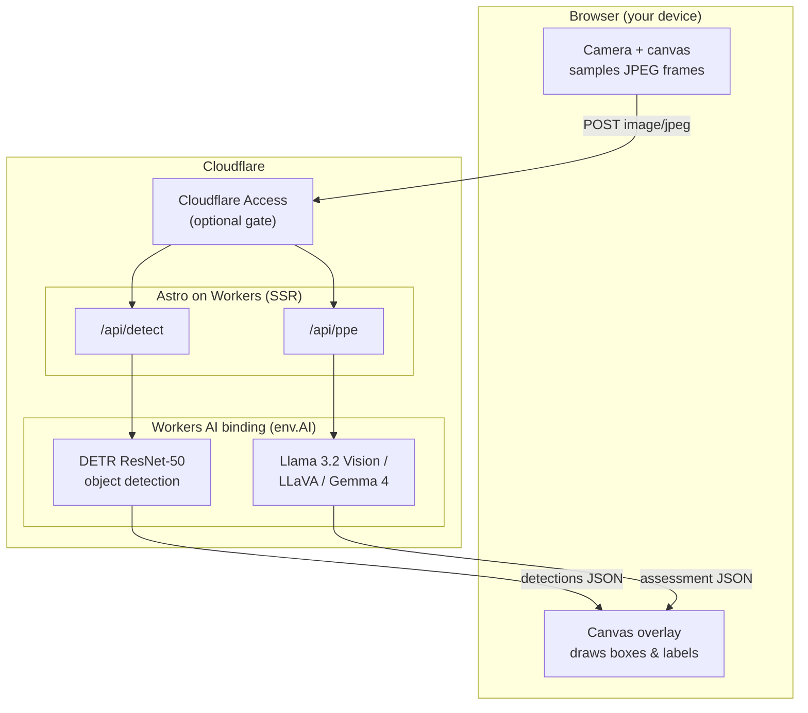

# Cloudflare Workers AI Vision Demo

[](LICENSE)
[](https://astro.build)
[](https://workers.cloudflare.com)

> A real-time computer-vision demo on Cloudflare's developer platform: it streams your device camera to **Workers AI**, runs object detection and multimodal vision models at the edge, and draws the results back over the live video — all from a single [Astro](https://astro.build) app deployed as one Cloudflare Worker.

No database, no build-time secrets, and no extra services. Just a browser, an Astro Worker, and the Workers AI binding.

> [!NOTE]
> **Disclaimer — personal project.** This is a personal, community demo built to show off the Cloudflare developer platform. It is **not an official Cloudflare product** and is not affiliated with, endorsed by, or supported by Cloudflare, Inc. It is provided "as is" for demonstration and educational purposes. "Cloudflare", "Workers", and "Workers AI" are trademarks of Cloudflare, Inc.

## Quick look

The entire object-detection backend is essentially three lines — the Workers AI binding does the heavy lifting:

```ts
// src/pages/api/detect.ts
const image = await request.arrayBuffer();                 // raw JPEG from the browser
const detections = await env.AI.run('@cf/facebook/detr-resnet-50', {
  image: [...new Uint8Array(image)],                       // bytes → Workers AI
});
// → [{ label: "person", score: 0.98, box: { xmin, ymin, xmax, ymax } }, ...]
```

The browser samples frames from `getUserMedia()`, POSTs them to this route at ~1.5 fps, and renders the returned boxes on a `<canvas>` overlay.

## Table of contents

- [Features](#features)
- [Architecture](#architecture)
- [Tech stack](#tech-stack)
- [Prerequisites](#prerequisites)
- [Getting started](#getting-started)
- [Deploy to Cloudflare](#deploy-to-cloudflare)
- [How it works](#how-it-works)
- [Configuration](#configuration)
- [Optional: gate the deployment with Cloudflare Access](#optional-gate-the-deployment-with-cloudflare-access)
- [Cost](#cost)
- [Troubleshooting](#troubleshooting)
- [Project structure](#project-structure)
- [Contributing](#contributing)
- [License](#license)
- [Acknowledgments](#acknowledgments)

## Features

Four views, all served by the same Worker, each showing a different Workers AI pattern:

| Route | View | What it shows | Models |
| --- | --- | --- | --- |
| `/` | **Live object detection** | One inference per sampled frame; boxes + confidence drawn over the feed | `@cf/facebook/detr-resnet-50` |
| `/zone` | **Zone monitor** | Person boxes intersected with a user-drawn zone; logs entry/exit events (all in-browser state) | `@cf/facebook/detr-resnet-50` + browser geometry |
| `/ppe` | **PPE compliance** | Fast person tracking + a slower vision-LLM that checks for a hardhat or baseball cap | DETR + selectable vision model |
| `/architecture` | **Reference architecture** | A static diagram and per-route flow breakdown | — |

The `/ppe` view lets you switch between three multimodal models to compare quality, latency, and cost:

- `@cf/meta/llama-3.2-11b-vision-instruct`
- `@cf/llava-hf/llava-1.5-7b-hf`
- `@cf/google/gemma-4-26b-a4b-it`

## Architecture



**Key design decisions.** Expensive work (inference) is pushed to the `AI` binding while the browser keeps capture and overlay state lightweight. All application state — zones, event logs, model choice — is tab-local, so the demo needs no database or KV. Camera frames are sampled and downscaled in the browser to keep payloads small and inference cheap. Cloudflare Access is shown as an **optional** front door, not a requirement.

## Tech stack

| Layer | Technology |
| --- | --- |
| Framework | [Astro 6](https://astro.build) (SSR) |
| Hosting / compute | [Cloudflare Workers](https://workers.cloudflare.com) via [`@astrojs/cloudflare`](https://docs.astro.build/en/guides/integrations-guide/cloudflare/) |
| AI inference | [Workers AI](https://developers.cloudflare.com/workers-ai/) (`env.AI` binding) |
| Tooling | [Wrangler 4](https://developers.cloudflare.com/workers/wrangler/), TypeScript |
| Frontend | Vanilla browser APIs — `getUserMedia`, `<canvas>`, `fetch` (no client framework) |

## Prerequisites

- **[Node.js](https://nodejs.org) ≥ 22.12.0** and npm.
- **A [Cloudflare account](https://dash.cloudflare.com/sign-up).** The free plan works; Workers AI includes a free daily allocation and then bills per usage (see [Cost](#cost)).
- **Workers AI** is available on all accounts by default — no extra signup.
- **Wrangler** is installed as a dev dependency, so you can run it with `npx wrangler` (or the npm scripts below).

## Getting started

```bash
# 1. Clone
git clone https://github.com/<your-username>/cloudflare-workers-ai-vision-demo.git
cd cloudflare-workers-ai-vision-demo

# 2. Install dependencies
npm install

# 3. Authenticate Wrangler with your Cloudflare account
npx wrangler login

# 4. Start the dev server
npm run dev
```

Then open **http://localhost:4321** and click **Start camera**.

> **Heads up — local dev calls *real* Workers AI.** This project's `AI` binding is configured with `"remote": true` in `wrangler.jsonc`, which means even `npm run dev` sends inference to Cloudflare's hosted models (there is no local AI emulator). That is why step 3 (`wrangler login`) is required, and why local usage is billed like production.

> **Multiple Cloudflare accounts?** If your login has access to more than one account, tell Wrangler which one to use:
>
> ```bash
> CLOUDFLARE_ACCOUNT_ID=<your_account_id> npm run dev
> ```
>
> Find your account ID in the [Cloudflare dashboard](https://dash.cloudflare.com) under **Workers & Pages → Account details**.

## Deploy to Cloudflare

```bash
# Build the Astro app and deploy the Worker in one step
npm run deploy

# …or, with an explicit account:
CLOUDFLARE_ACCOUNT_ID=<your_account_id> npm run deploy
```

Wrangler prints a `https://cloudflare-workers-ai-vision-demo.<your-subdomain>.workers.dev` URL. Open it on a phone or laptop and start the camera.

The camera requires a **secure context (HTTPS)**, which `workers.dev` provides automatically. To use your own domain, see [Custom Domains](https://developers.cloudflare.com/workers/configuration/routing/custom-domains/).

## How it works

1. The browser starts `getUserMedia()` and renders the camera stream into a `<video>` element.
2. A hidden `<canvas>` samples frames at ~1.5 fps, downscales them to 640×360, and encodes a compressed JPEG.
3. The frame is POSTed as a raw `image/*` body to an Astro API route (`/api/detect` or `/api/ppe`).
4. The route calls the Workers AI binding — e.g. `env.AI.run('@cf/facebook/detr-resnet-50', { image })` — and returns JSON.
5. The browser scales the model's coordinates back to the on-screen video size and draws boxes/labels on a second `<canvas>` overlay.
6. `/zone` intersects person boxes with a normalized, locally-stored zone and logs debounced entry/exit events.
7. `/ppe` runs two loops in parallel: a fast DETR loop for responsive boxes and a slower vision-LLM loop (every ~3s) for headwear compliance.

> **Llama Vision one-time license.** `@cf/meta/llama-3.2-11b-vision-instruct` requires a one-time license agreement per Cloudflare account. The `/api/ppe` route handles this automatically: if the first request returns a license error, it sends `{ prompt: "agree" }` and retries. The very first Llama call after deploy may therefore be slightly slower.

## Configuration

This demo needs **no `.env` file and no secrets.** The only binding is Workers AI (`AI`), and the only "configuration" is which Cloudflare account to deploy to:

- **`CLOUDFLARE_ACCOUNT_ID`** (environment variable) — only needed when your login has multiple accounts.
- Alternatively, pin the account permanently by adding `"account_id": "<your_account_id>"` to `wrangler.jsonc`.

Other tunables live at the top of each demo's inline `<script>` (e.g. `sampleMs` for frame cadence, `minScore` for the confidence threshold, `captureWidth`/`captureHeight` for frame size) and in [`wrangler.jsonc`](wrangler.jsonc), which is commented field-by-field.

## Optional: gate the deployment with Cloudflare Access

By default the deployed Worker is reachable by anyone with the URL. If you want to restrict it to specific people (for an internal demo, say), put **[Cloudflare Access](https://developers.cloudflare.com/cloudflare-one/policies/access/)** in front of it:

1. In the [Zero Trust dashboard](https://one.dash.cloudflare.com), create a **self-hosted Access application** for your `workers.dev` (or custom) hostname.
2. Add a policy — for example, allow only specific email addresses or an email domain.

No code changes are required; Access sits in front of the Worker. This is the "optional gate" shown in the architecture diagram.

## Cost

- **Workers AI is billed by usage** (DETR per inference; the vision LLMs per input/output token), after a free daily allocation. See the [Workers AI pricing](https://developers.cloudflare.com/workers-ai/platform/pricing/) page for current rates.
- Object detection with DETR is very cheap per frame; the multimodal models on `/ppe` cost meaningfully more, which is why that view runs them on a slow cadence.
- The biggest cost lever is the **sampling rate** — raise `sampleMs` (fewer frames per second) to spend less.
- Because the `AI` binding is `remote: true`, **local development is billed the same as production.**

## Troubleshooting

| Symptom | Fix |
| --- | --- |
| Camera won't start | Camera APIs require HTTPS. Use the `workers.dev` URL, or `localhost` for dev. Also confirm you granted the browser camera permission. |
| `getUserMedia is not a function` | Use a current desktop or mobile browser in a secure context. |
| First `/ppe` Llama request is slow or errors once | Expected — it's the one-time license agreement, accepted automatically on retry. |
| `Authentication error` / wrong account during dev or deploy | Run `npx wrangler login`, and set `CLOUDFLARE_ACCOUNT_ID` if you belong to multiple accounts. |
| TypeScript can't find the `Env` / `AI` types | Run `npm run cf-typegen` (alias for `wrangler types`). It also runs automatically on `dev`/`build`. |

## Project structure

```
cloudflare-workers-ai-vision-demo/
├── src/
│   ├── pages/
│   │   ├── index.astro          # `/` live object detection
│   │   ├── zone.astro           # `/zone` virtual-perimeter monitor
│   │   ├── ppe.astro            # `/ppe` PPE compliance
│   │   ├── architecture.astro   # `/architecture` reference diagram
│   │   └── api/
│   │       ├── detect.ts        # POST /api/detect → DETR object detection
│   │       └── ppe.ts           # POST /api/ppe → selectable vision LLM
│   ├── components/              # Hero, Header/Footer/NavTabs, and the 3 demo widgets
│   ├── layouts/Layout.astro     # Shared HTML shell + scroll-reveal + theming
│   └── styles/                  # Design tokens + base styles
├── public/                      # favicon + the architecture SVG
├── astro.config.mjs             # Astro + Cloudflare adapter
├── wrangler.jsonc               # Worker config (AI binding, assets) — fully commented
├── package.json
├── LICENSE
├── CONTRIBUTING.md
└── README.md
```

> `worker-configuration.d.ts` is **generated** by `wrangler types` (it runs automatically on `dev`/`build`) and is git-ignored. You won't see it until the first build — that's expected.

## Contributing

Contributions are welcome! Please read the [Contributing Guide](CONTRIBUTING.md) and our [Code of Conduct](CODE_OF_CONDUCT.md) before opening an issue or pull request.

## License

This project is licensed under the MIT License — see the [LICENSE](LICENSE) file for details.

## Acknowledgments

- [Cloudflare Workers AI](https://developers.cloudflare.com/workers-ai/) and the [DETR](https://developers.cloudflare.com/workers-ai/models/detr-resnet-50/) / Llama Vision / LLaVA / Gemma models.
- [Astro](https://astro.build) and the [`@astrojs/cloudflare`](https://docs.astro.build/en/guides/integrations-guide/cloudflare/) adapter.
- Scaffolded with [`create-cloudflare`](https://developers.cloudflare.com/workers/get-started/quickstarts/).
