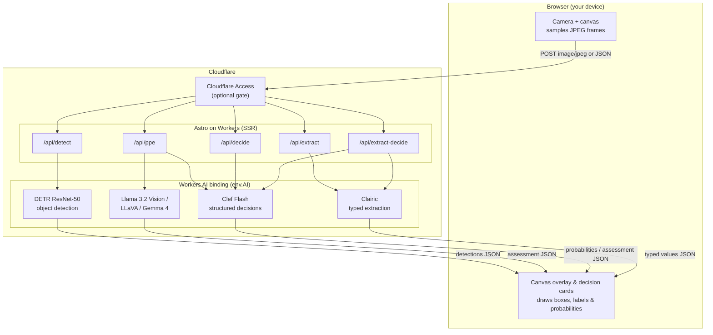

# Cloudflare Workers AI Vision Demo

[](LICENSE)
[](https://astro.build)
[](https://workers.cloudflare.com)

> A real-time computer-vision demo on Cloudflare's developer platform: it streams your device camera to **Workers AI**, runs object detection and multimodal vision models at the edge, and draws the results back over the live video — all from a single [Astro](https://astro.build) app deployed as one Cloudflare Worker.

No manually-created databases, no build-time secrets, and no `.env` file. Just a browser, an Astro Worker, and the Workers AI binding. The Astro Cloudflare adapter may automatically provision support bindings at deploy time, such as `SESSION` for Astro sessions and `IMAGES` for the Astro image service.

> [!NOTE]
> **Disclaimer — personal project.** This is a personal, community demo built to show off the Cloudflare developer platform. It is **not an official Cloudflare product** and is not affiliated with, endorsed by, or supported by Cloudflare, Inc. It is provided "as is" for demonstration and educational purposes. "Cloudflare", "Workers", and "Workers AI" are trademarks of Cloudflare, Inc.

## Quick look

The entire object-detection backend is essentially three lines — the Workers AI binding does the heavy lifting:

```ts
// src/pages/api/detect.ts
const image = await request.arrayBuffer();                 // raw JPEG from the browser
const detections = await env.AI.run('@cf/facebook/detr-resnet-50', {
  image: [...new Uint8Array(image)],                       // bytes → Workers AI
});
// → [{ label: "person", score: 0.98, box: { xmin, ymin, xmax, ymax } }, ...]
```

The browser samples frames from `getUserMedia()`, POSTs them to this route at ~1.5 fps, and renders the returned boxes on a `<canvas>` overlay.

## Table of contents

- [Features](#features)
- [Architecture](#architecture)
- [Tech stack](#tech-stack)
- [Prerequisites](#prerequisites)
- [Getting started](#getting-started)
- [Deploy to Cloudflare](#deploy-to-cloudflare)
- [How it works](#how-it-works)
- [Configuration](#configuration)
- [Optional: gate the deployment with Cloudflare Access](#optional-gate-the-deployment-with-cloudflare-access)
- [Cost](#cost)
- [Troubleshooting](#troubleshooting)
- [Project structure](#project-structure)
- [Contributing](#contributing)
- [License](#license)
- [Acknowledgments](#acknowledgments)

## Features

Seven views, all served by the same Worker, each showing a different Workers AI pattern:

| Route | View | What it shows | Models |
| --- | --- | --- | --- |
| `/` | **Live object detection** | One inference per sampled frame; boxes + confidence drawn over the feed | `@cf/facebook/detr-resnet-50` |
| `/zone` | **Zone monitor** | Person boxes intersected with a user-drawn zone; logs entry/exit events (all in-browser state) | `@cf/facebook/detr-resnet-50` + browser geometry |
| `/ppe` | **PPE compliance** | Fast person tracking + a slower vision model that checks for a hardhat or baseball cap | DETR + selectable vision model |
| `/decide` | **Decision dashboard** | Evaluates 1–64 typed `noul`, `choice`, and `score` questions in a single forward pass with calibrated probability bars, built-in presets (`webcam`, `safety`, `emoji`, `bin`), and a live JSON question editor (`E`) | `@cf/cloudflare/clef-flash` |
| `/extract` | **Extraction dashboard** | Reads 1–32 typed fields (`text`, `number`, `date`, `time`, `datetime`, `duration`, `list`, `estimate`, `forecast`) from each frame with a confidence or p10–p90 interval per answer, built-in presets (`scene`, `site`), and a live JSON field editor (`E`) | `@cf/cloudflare/clairic` (preview) |
| `/extract-decide` | **Extract + Decide** | Recipes that chain both models on one frame: Clef Flash gates and routes, Clairic measures, the Worker does the maths. *Drink Check* (hydration / caffeine / standard drinks), *Finger Math*, *Tech Neck*, *Watch Reader* | `@cf/cloudflare/clef-flash` + `@cf/cloudflare/clairic` |
| `/architecture` | **Reference architecture** | A static diagram and per-route flow breakdown | — |

The `/ppe` view lets you switch between four multimodal models to compare quality, latency, and cost:

- `@cf/meta/llama-3.2-11b-vision-instruct` (`?model=llama`)
- `@cf/llava-hf/llava-1.5-7b-hf` (`?model=llava`)
- `@cf/google/gemma-4-26b-a4b-it` (`?model=gemma`)
- `@cf/cloudflare/clef-flash` (`?model=clef-flash`)

The `/decide` view and `POST /api/decide` endpoint evaluate live frames against typed decision schemas using `@cf/cloudflare/clef-flash`:

- **`noul`**: binary probability (`P(yes)` in `[0, 1]`) with a Yes/No verdict badge and probability meter.
- **`choice`**: multi-class distribution (2–255 options) with the winning choice, confidence, and sorted option probability bars.
- **`score`**: ordered rubric (2–10 levels) with probability-weighted expected score, active legend label, confidence, and per-level probability bars.
- **Safety & Field** (`?preset=safety`): a site safety check against a stated rule ("hardhat and hi-vis vest required"). Clef Flash answers person in view, headwear, hi-vis vest, visible hazard, and a safety level whose options name what you can see: 🟢 All clear · 🟡 Check (can't tell) · 🟠 Violation (missing a hardhat or vest) · 🔴 Stop work (missing both, or near a hazard). The view shows the level large with a checklist of what it saw (⛑️ Hardhat ❌ baseball cap 82% · 🦺 Hi-vis vest ✅ 91%). At a booth everyone starts 🟠; put on a hardhat and vest to go 🟢.
- **Emoji** (`?preset=emoji`): Clef Flash checks a face is visible and picks the emoji that best matches it from 70 options in one call. Each option's description leads with the emoji and says what the face looks like (`src/lib/emoji-faces.ts`). The view shows the winning emoji large, with the next three and their probabilities. Expressions only: no one is identified and nothing is stored.
- **Which Bin?** (`?preset=bin`): hold up something you'd throw away. One Clef Flash call, four questions: is an item shown, which of 17 common booth items it is, which bin (compost, recycling, landfill, special drop-off) its main body goes in, and which bin its lid or cap goes in, under typical US curbside rules. Other parts with an obvious bin (a cup's cardboard sleeve, a badge's paper insert) come from a fixed table in `src/lib/bins.ts`, marked "rule". The view lists the picked item's parts (coffee cup: lid → landfill, cup → landfill, sleeve → recycling) and shows only the relevant question cards. Empty frames show "Hold up something you'd throw away." About 1 s and 2,100 input tokens per frame.
- **Presets & custom JSON**: switch between `Webcam & Gestures` (`?preset=webcam`), `Safety & Field` (`?preset=safety`), `Emoji` (`?preset=emoji`), and `Which Bin?` (`?preset=bin`), or open the live question editor (`Edit questions (E)` or press `E`) to edit `state` and `questions` JSON directly in the browser (persisted in `localStorage`).

The `/extract` view and `POST /api/extract` endpoint read typed values from live frames against a **Field Schema** using `@cf/cloudflare/clairic` (preview):

- **Scalars** (`text`, `number`, `date`, `time`, `datetime`, `duration`): the value, or *Not found* with the model's best guess and `P(not present)`, plus a confidence bar.
- **`list`**: the extracted items as chips (`items` is `text`, `number`, or `date`).
- **`estimate`**: the median with its p10–p90 interval drawn across the field's `min`–`max` range.
- **`forecast`**: one median and interval per step (`horizon`, `interval`).
- **Presets & custom JSON**: switch between `Webcam & Objects` (`?preset=scene`) and `Site & Gauges` (`?preset=site`), or open the live field editor (`Edit fields (E)` or press `E`) to edit `state` and `fields` JSON (persisted in `localStorage`). An inline schema replaces the preset; it is never merged.
- **One validator**: the Field Schema rules live in `src/lib/field-schema.ts`. The API route and the bundled browser editor both import it, so the editor rejects exactly what the API would.

The `/extract-decide` view and `POST /api/extract-decide` endpoint run **recipes** that combine both models (`src/lib/extract-decide.ts`):

- **Gate → measure**: Clef Flash answers the recipe's questions first. If there is nothing to measure, Clairic is never called; otherwise the answers pick the Field Schema. *Drink Check* routes by drink type to hydration (% of a daily goal), caffeine (weighted by Clef Flash's drink-type probabilities), or alcohol (ABV from the label when readable, else a typical range → standard drinks).
- **Finger Math**: Clef Flash checks two hands are raised; Clairic counts the fingers on the right and left hands (plain integer counts, tuned live) and gives its own product; the Worker multiplies and shows "Clairic said X" if Clairic's product disagrees.
- **Tech Neck**: Clef Flash checks a person is in view and classifies posture; Clairic estimates forward head tilt (0–60°); the Worker converts tilt to approximate neck load from published modelling (Hansraj, 2014). Just for fun, not medical advice.
- **Watch Reader**: analog watches (the challenge) or phone lock screens. Clef Flash classifies analog vs digital, spots a seconds hand (the thinnest of three, kept out of the reading), finds the crown (so a rotated watch still works: 12 is a quarter-turn counter-clockwise from the crown), and gives each hand's rough image position. Clairic reads the time directly and measures both hands' angles. The Worker rotates everything onto the dial (`src/lib/clock.ts`), takes **minutes** from whichever Clairic reading agrees best with Clef Flash's minute-hand position, and the **hour** from Clef Flash's hour-hand position plus those minutes (so a hand nearest 4 at :50 reads 3, the classic "3:50 trap"). The browser compares the reading with its own clock, which never goes into the models' input: "4 min fast", "still on home time? (+3 h)", or "stopped, or never set?". A dial diagram shows the final hands over Clairic's measured ranges. Captured at 1280×720.
- **Settings**: only Drink Check shows one, the daily water goal (2.0–3.7 L) behind its hydration %. Standard drinks use the US definition (14 g of alcohol), are informational only, and nothing estimates impairment.

## Architecture



**Key design decisions.** Expensive work (inference) is pushed to the `AI` binding while the browser keeps capture and overlay state lightweight. App-specific state — zones, event logs, model choice, custom Clef question and Clairic field schemas — is tab-local, so the demo does not require you to create a database, KV namespace, or storage bucket before deploying. Camera frames are sampled and downscaled in the browser to keep payloads small and inference cheap. Cloudflare Access is shown as an **optional** front door, not a requirement.

## Tech stack

| Layer | Technology |
| --- | --- |
| Framework | [Astro 6](https://astro.build) (SSR) |
| Hosting / compute | [Cloudflare Workers](https://workers.cloudflare.com) via [`@astrojs/cloudflare`](https://docs.astro.build/en/guides/integrations-guide/cloudflare/) |
| AI inference | [Workers AI](https://developers.cloudflare.com/workers-ai/) (`env.AI` binding) |
| Tooling | [Wrangler 4](https://developers.cloudflare.com/workers/wrangler/), TypeScript |
| Frontend | Vanilla browser APIs — `getUserMedia`, `<canvas>`, `fetch` (no client framework) |

## Prerequisites

- **[Node.js](https://nodejs.org) ≥ 22.12.0** and npm.
- **A [Cloudflare account](https://dash.cloudflare.com/sign-up).** The free plan works; Workers AI includes a free daily allocation and then bills per usage (see [Cost](#cost)).
- **Workers AI** is available on all accounts by default — no extra signup.
- **Wrangler** is installed as a dev dependency, so you can run it with `npx wrangler` (or the npm scripts below).

## Getting started

```bash
# 1. Clone
git clone https://github.com/Gryczka/cloudflare-workers-ai-vision-demo.git
cd cloudflare-workers-ai-vision-demo

# 2. Install dependencies
npm install

# 3. Authenticate Wrangler with your Cloudflare account
npx wrangler login

# 4. Run the offline unit tests (no Cloudflare credentials required)
npm test

# 5. Start the dev server
npm run dev
```

Then open **http://localhost:4321** and click **Start camera**.

> **Heads up — local dev calls *real* Workers AI.** This project's `AI` binding is configured with `"remote": true` in `wrangler.jsonc`, which means even `npm run dev` sends inference to Cloudflare's hosted models (there is no local AI emulator). That is why step 3 (`wrangler login`) is required, and why local usage is billed like production.

> **Multiple Cloudflare accounts?** If your login has access to more than one account, tell Wrangler which one to use:
>
> ```bash
> CLOUDFLARE_ACCOUNT_ID=<your_account_id> npm run dev
> ```
>
> Find your account ID in the [Cloudflare dashboard](https://dash.cloudflare.com) under **Workers & Pages → Account details**.

## Deploy to Cloudflare

```bash
# Build the Astro app and deploy the Worker in one step
npm run deploy

# …or, with an explicit account:
CLOUDFLARE_ACCOUNT_ID=<your_account_id> npm run deploy
```

Wrangler prints a `https://cloudflare-workers-ai-vision-demo.<your-subdomain>.workers.dev` URL. Open it on a phone or laptop and start the camera.

The camera requires a **secure context (HTTPS)**, which `workers.dev` provides automatically. To use your own domain, see [Custom Domains](https://developers.cloudflare.com/workers/configuration/routing/custom-domains/).

## How it works

1. The browser starts `getUserMedia()` and renders the camera stream into a `<video>` element.
2. A hidden `<canvas>` samples frames at ~1.5 fps, downscales them to 640×360, and encodes a compressed JPEG.
3. The frame is POSTed as a raw `image/*` body (or `application/json` with custom schemas on `/decide` and `/extract`) to an Astro API route (`/api/detect`, `/api/ppe`, `/api/decide`, or `/api/extract`).
4. The route calls the Workers AI binding — e.g. `env.AI.run('@cf/facebook/detr-resnet-50', { image })` or `env.AI.run('@cf/cloudflare/clef-flash', { model: 'clef-flash', state, images, questions })` — and returns JSON.
5. The browser scales the model's coordinates back to the on-screen video size and draws boxes/labels on a second `<canvas>` overlay (or renders live probability cards on `/decide` and typed value cards on `/extract`).
6. `/zone` intersects person boxes with a normalized, locally-stored zone and logs debounced entry/exit events.
7. `/ppe` runs two loops in parallel: a fast DETR loop for responsive boxes and a slower vision-model loop (every ~3s) for headwear compliance using Llama Vision, LLaVA, Gemma 4, or Clef Flash.
8. `/decide` evaluates each sampled frame against 1–64 typed `noul`, `choice`, and `score` questions in a single forward pass with `@cf/cloudflare/clef-flash` and zero output-token generation.
9. `/extract` reads each sampled frame (~0.8 fps) against 1–32 typed fields with `@cf/cloudflare/clairic`, returning values with confidences and estimate intervals.
10. `/extract-decide` runs a recipe per frame (~0.7 fps): Clef Flash gates and routes, Clairic measures, and the Worker combines them into one result.

> **Llama Vision one-time license.** `@cf/meta/llama-3.2-11b-vision-instruct` requires a one-time license agreement per Cloudflare account. The `/api/ppe` route handles this automatically: if the first request returns a license error, it sends `{ prompt: "agree" }` and retries. The very first Llama call after deploy may therefore be slightly slower.

## Configuration

This demo needs **no `.env` file and no secrets.** The only application binding you configure directly is Workers AI (`AI`), and the only required "configuration" is which Cloudflare account to deploy to:

- **`CLOUDFLARE_ACCOUNT_ID`** (environment variable) — only needed when your login has multiple accounts.
- Alternatively, pin the account permanently by adding `"account_id": "<your_account_id>"` to `wrangler.jsonc`.

Astro's Cloudflare adapter can also add automatically provisioned support bindings when you build/deploy, including `SESSION` for Astro sessions and `IMAGES` for the default Cloudflare image service. You do not need to create those manually for this demo.

Other tunables live at the top of each demo's inline `<script>` (e.g. `sampleMs` for frame cadence, `minScore` for the confidence threshold, `captureWidth`/`captureHeight` for frame size) and in [`wrangler.jsonc`](wrangler.jsonc), which is commented field-by-field.

## Optional: gate the deployment with Cloudflare Access

By default the deployed Worker is reachable by anyone with the URL. If you want to restrict it to specific people (for an internal demo, say), put **[Cloudflare Access](https://developers.cloudflare.com/cloudflare-one/policies/access/)** in front of it:

1. In the [Zero Trust dashboard](https://one.dash.cloudflare.com), create a **self-hosted Access application** for your `workers.dev` (or custom) hostname.
2. Add a policy — for example, allow only specific email addresses or an email domain.

No code changes are required; Access sits in front of the Worker. This is the "optional gate" shown in the architecture diagram.

## Cost

- **Workers AI is billed by usage** (DETR per inference; the vision LLMs per input/output token), after a free daily allocation. See the [Workers AI pricing](https://developers.cloudflare.com/workers-ai/platform/pricing/) page for current rates.
- Object detection with DETR is very cheap per frame; the multimodal models on `/ppe` cost meaningfully more, which is why that view runs them on a slow cadence.
- The biggest cost lever is the **sampling rate** — raise `sampleMs` (fewer frames per second) to spend less.
- Because the `AI` binding is `remote: true`, **local development is billed the same as production.**

## Troubleshooting

| Symptom | Fix |
| --- | --- |
| Camera won't start | Camera APIs require HTTPS. Use the `workers.dev` URL, or `localhost` for dev. Also confirm you granted the browser camera permission. |
| `getUserMedia is not a function` | Use a current desktop or mobile browser in a secure context. |
| First `/ppe` Llama request is slow or errors once | Expected — it's the one-time license agreement, accepted automatically on retry. |
| `Authentication error` / wrong account during dev or deploy | Run `npx wrangler login`, and set `CLOUDFLARE_ACCOUNT_ID` if you belong to multiple accounts. |
| TypeScript can't find the `Env` / `AI` types | Run `npm run cf-typegen` (alias for `wrangler types`). It also runs automatically on `dev`/`build`. |

## Project structure

```
cloudflare-workers-ai-vision-demo/
├── src/
│   ├── pages/
│   │   ├── index.astro          # `/` live object detection
│   │   ├── zone.astro           # `/zone` virtual-perimeter monitor
│   │   ├── ppe.astro            # `/ppe` PPE compliance
│   │   ├── architecture.astro   # `/architecture` reference diagram
│   │   └── api/
│   │       ├── detect.ts        # POST /api/detect → DETR object detection
│   │       ├── ppe.ts           # POST /api/ppe → selectable vision model / Clef Flash
│   │       ├── decide.ts        # POST /api/decide → @cf/cloudflare/clef-flash decisions
│   │       ├── extract.ts       # POST /api/extract → @cf/cloudflare/clairic extraction
│   │       └── extract-decide.ts # POST /api/extract-decide → Clef Flash + Clairic recipes
│   ├── components/              # Hero, Header/Footer/NavTabs, and the 6 demo widgets
│   ├── lib/api-helpers.ts       # Shared AI runner seam, image normalization, JSON responses
│   ├── lib/field-schema.ts      # Field Schema presets + validator (shared by API and browser)
│   ├── lib/extract-decide.ts    # Extract + Decide recipes, gating/routing, result maths
│   ├── lib/emoji-faces.ts       # 70 face emoji + descriptions for the Decide Emoji preset
│   ├── lib/clock.ts             # Watch Reader geometry: hand angles → time, clock comparison
│   ├── lib/bins.ts              # Which Bin? items, parts, bins, and the one-call question set
│   ├── test/                    # Hermetic offline contract tests (`npm test`)
│   ├── layouts/Layout.astro     # Shared HTML shell + scroll-reveal + theming
│   └── styles/                  # Design tokens + base styles
├── public/                      # favicon + the architecture SVG
├── astro.config.mjs             # Astro + Cloudflare adapter
├── wrangler.jsonc               # Worker config (AI binding, assets) — fully commented
├── package.json
├── LICENSE
├── CONTRIBUTING.md
└── README.md
```

> `worker-configuration.d.ts` is **generated** by `wrangler types` (it runs automatically on `dev`/`build`) and is git-ignored. You won't see it until the first build — that's expected.

## Contributing

Contributions are welcome! Please read the [Contributing Guide](CONTRIBUTING.md) and our [Code of Conduct](CODE_OF_CONDUCT.md) before opening an issue or pull request.

## License

This project is licensed under the MIT License — see the [LICENSE](LICENSE) file for details.

## Acknowledgments

- [Cloudflare Workers AI](https://developers.cloudflare.com/workers-ai/) and the [DETR](https://developers.cloudflare.com/workers-ai/models/detr-resnet-50/), [Clef Flash](https://developers.cloudflare.com/workers-ai/models/clef-flash/), Llama Vision, LLaVA, and Gemma models.
- [Astro](https://astro.build) and the [`@astrojs/cloudflare`](https://docs.astro.build/en/guides/integrations-guide/cloudflare/) adapter.
- Scaffolded with [`create-cloudflare`](https://developers.cloudflare.com/workers/get-started/quickstarts/).
